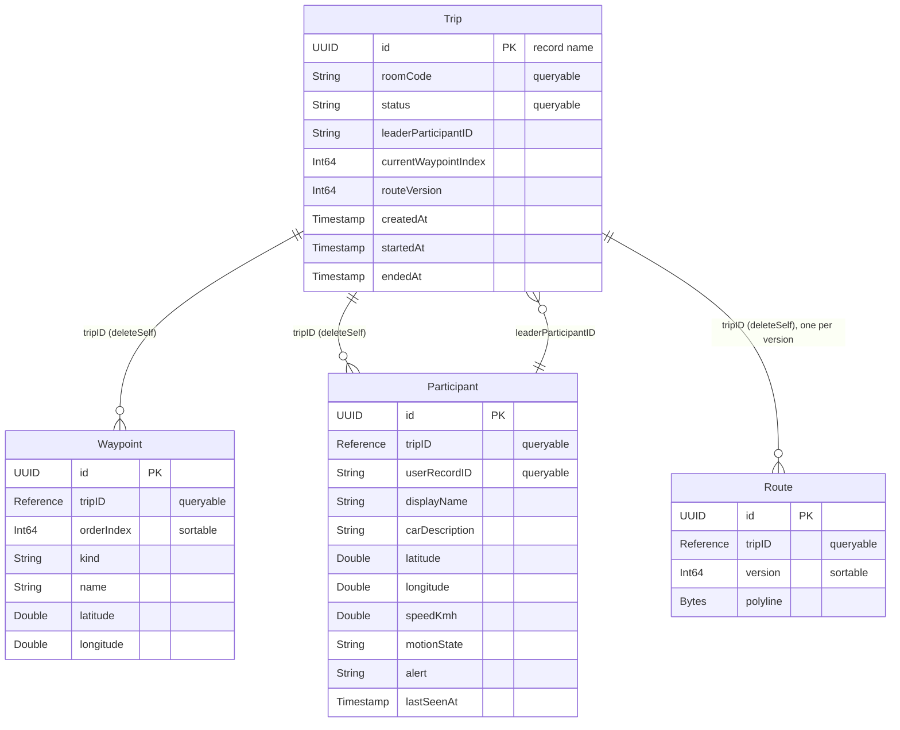

# How trip sync works

This guide explains the trip data layer end to end: the shared models, `TripService`, the in-memory and CloudKit implementations, the database schema, how phones stay in sync, how it was measured, and how a screen uses it.

The decisions behind it are in [ADR 0014](../docs/adr/0014-CloudKitPublicDatabaseForTripSync.md) (CloudKit public database) and [ADR 0017](../docs/adr/0017-TripServiceContractFirst.md) (contract first, with an in-memory service). The schema and how to import it are in [README.md](README.md).

## Contents

1. [The big picture](#1-the-big-picture)
2. [Models](#2-models)
3. [TripService](#3-tripservice)
4. [TripServiceError](#4-tripserviceerror)
5. [InMemoryTripService](#5-inmemorytripservice)
6. [How a screen gets the service](#6-how-a-screen-gets-the-service)
7. [The CloudKit layer](#7-the-cloudkit-layer)
8. [Schema](#8-schema)
9. [How phones stay in sync](#9-how-phones-stay-in-sync)
10. [Speed and the load check](#10-speed-and-the-load-check)
11. [Tests](#11-tests)
12. [Debug tools](#12-debug-tools)
13. [Using the service in your screen](#13-using-the-service-in-your-screen)
14. [Open work](#14-open-work)
15. [CloudKit terms](#15-cloudkit-terms)
16. [Files](#16-files)

---

## 1. The big picture

Every phone in a trip must see the same route, members, status and car positions. They share them through the **CloudKit public database** of the app's container (ADR 0014): no server, no sign-up, no third-party dependency.

The code is layered. Each layer only knows the one below it:

```
Screen (View)        reads @Environment(\.tripService)
   │
ViewModel            receives a TripService in its initializer
   │
protocol TripService (15 operations on the shared models)      ◄── the contract
   │                                   │
InMemoryTripService                 LiveTripService
(previews, tests, DebugScreen)      (the app)
   │                                   │
InMemoryTripStore                   TripRecordReader, TripRecordMapper
                                       │
                                    protocol CloudDatabase
                                       │                      │
                                    LiveCloudDatabase        FakeCloudDatabase
                                    (CloudKit)               (tests only)
```

Why this shape (ADR 0017):

- **Screens never touch CloudKit.** They only know `TripService` and the shared models, so CloudKit can be changed or sped up without changing a screen. The speed work in #178 changed no screen.
- **The contract came first.** Models and protocol were merged before CloudKit (#130), so every screen builds on the same types while the CloudKit side was built behind them.
- **Two implementations, one set of rules.** `InMemoryTripService` and `LiveTripService` run the **same behaviour tests** (section 11). A screen that works with one works with the other.

---

## 2. Models

Files: `Lezgo/Models/`. All models are plain `Hashable`, `Codable` structs. They import neither SwiftUI nor CloudKit. Fields follow "Data model" in `specs/UserStories.md`.

### 2.1 The four stored models

**`Trip`**: one group journey.

| Field | Meaning |
| --- | --- |
| `id` | Also the CloudKit record name |
| `roomCode` | Six digits, for example `"897654"` |
| `status` | `TripStatus` |
| `leaderParticipantID` | **The only place the leader is stored** |
| `currentWaypointIndex` | The waypoint the group drives to. Lower `orderIndex` values are visited |
| `routeVersion` | Goes up by one with every new route; phones never go back to an older one |
| `createdAt`, `startedAt?`, `endedAt?` | Timestamps |

> **Why the leader lives only on `Trip`:** if each participant had an `isLeader` flag, two phones handing over the lead at the same moment could produce two leaders. One field on `Trip` makes that impossible. To ask "does this person lead?", use `participant.IsLeader(in: trip)`.

**`TripStatus`**: `.lobby` (`"LOBBY"`, Trip Room), `.inTrip` (`"IN_TRIP"`, on the road), `.ended` (`"ENDED"`, leader ended it on the road), `.cancelled` (`"CANCELLED"`, leader left the Trip Room). `status.isOpen` is true for `lobby` and `inTrip`, which can still be joined and changed.

**`Waypoint`**: `id`, `tripID`, `orderIndex` (0 is the start point, 1…n are checkpoints, n+1 is the destination), `kind` (`WaypointKind`: `.start`, `.checkpoint`, `.destination`), `name`, `coordinate`. `IsVisited(currentWaypointIndex:)` is `orderIndex < currentWaypointIndex`.

**`Participant`**: one person, one car, one phone.

| Field | Meaning |
| --- | --- |
| `id`, `tripID` | The record name and its trip |
| `userRecordID` | The iCloud user. Joining again with the same account returns this participant, never a second car |
| `displayName`, `carDescription` | Name and car |
| `coordinate?` | Last position; `nil` until the first one is sent |
| `speedKmh`, `motionState` | Speed, and `.driving` or `.stopped` |
| `alert` | `FormationAlert`: `.none`, `.offRoute`, `.passedCheckpoint`, `.aheadOfLeader` |
| `lastSeenAt` | When this phone last sent a position |

Rules: `IsLeader(in:)`; `IsOnline(at:)`, where a phone is offline when `lastSeenAt` is **more than** 120 seconds old (exactly 120 seconds is still online); and `Participant.Joining(…)`, a new participant with no position, stopped, and no alert.

**`Route`**: `id`, `tripID`, `version` (matches `Trip.routeVersion`), `polyline: [Coordinate]`.

### 2.2 Inputs and outputs

| Type | What it holds |
| --- | --- |
| `Coordinate` | `latitude`, `longitude`, and `Distance(to:)` in metres |
| `TripState` | `trip`, `waypoints` (in order), `participants`, `route?`, plus `leader` and `destination`. **Everything a screen needs about one trip at one moment**; `TripUpdates` sends these |
| `TripSession` | `myParticipantID` and `state`, returned by `CreateTrip` and `JoinTrip`. Keep `myParticipantID`: every later call needs it |
| `TripPlan` | `waypoints: [PlannedWaypoint]` and `polyline`, from the planner. `isValid` checks for a start first, a destination last, and only checkpoints between. `MakeWaypoints(tripID:)` turns the plan into waypoints |
| `PlannedWaypoint` | `kind`, `name`, `coordinate`: a waypoint before it belongs to a trip |
| `ParticipantProfile` | `displayName` and `carDescription`. `Default(forUserRecordID:)` gives "Member" plus the last 4 characters of the iCloud ID, for example "Member 7F3A" |
| `LocationUpdate` | `coordinate`, `speedKmh`, `motionState`, `recordedAt` |

The `TripMap…` types (`TripMapSnapshot`, `TripMapCar` and so on) belong to the trip map screen. They were built before the shared models existed and are being fed from `TripService` through an adapter (#170).

---

## 3. TripService

File: `Lezgo/Services/TripService.swift`. Every operation is `async`. All but `TripUpdates` throw `TripServiceError`.

| Operation | Who | Effect | Typical errors |
| --- | --- | --- | --- |
| `CreateTrip(plan:profile:)` | Leader | A trip in `LOBBY` with a unique 6-digit room code, route version 1, and the caller as leader | `notAllowed` (invalid plan), `notSignedInToICloud` |
| `JoinTrip(roomCode:profile:)` | Member | Joins as a member; joining again returns the same participant | `notFound` (wrong code), `tripEnded` |
| `FetchTrip(tripID:)` | Anyone | The trip as it is now (for example to resume) | `notFound` |
| `TripUpdates(tripID:)` | Anyone | **A stream:** the trip right away, then on every change | never throws |
| `StartTrip(tripID:by:)` | Leader | `LOBBY` → `IN_TRIP`, `currentWaypointIndex = 1` | `notAllowed` |
| `RemoveParticipants(_:tripID:by:)` | Leader | Removes members; the leader cannot remove themselves | `notAllowed` |
| `SetLeader(_:tripID:replacing:)` | Anyone | Hands over the lead **only if** `replacing` still leads | `conflict`, `notFound` |
| `ExitTrip(tripID:participantID:)` | Member | Deletes their participant; the leader must hand over or end instead | `notAllowed` for the leader |
| `EndTrip(tripID:by:)` | Leader | `LOBBY` → `CANCELLED`, `IN_TRIP` → `ENDED`; ending twice is harmless | `notAllowed` |
| `UpdateLocation(_:participantID:tripID:)` | Anyone | Position, speed, motion and `lastSeenAt`, about once a second | ignored, not an error, for a member who left |
| `SetAlert(_:participantID:tripID:)` | Member | Saves the formation alert | `notAllowed` for the leader |
| `AdvanceCheckpoint(to:tripID:by:)` | Leader | Moves forward only | `notAllowed` |
| `SaveRoute(_:tripID:by:)` | Leader | New route on the road (reroute or Edit Route): `routeVersion + 1`, index back to 1 | `notAllowed` |
| `StartNewDestination(_:tripID:by:)` | Leader | New Destination after arriving: new route, back to `LOBBY` with index 0; room code and members stay | `notAllowed` |
| `UpdateProfile(_:participantID:tripID:)` | Anyone | Name and car | `notFound` |

**`by leaderID`:** leader-only operations take the caller's ID and throw `.notAllowed` when that person is not the leader. The public database cannot check roles on the server, so the app checks them (ADR 0014).

**`replacing` in `SetLeader`:** a *conditional save*. When two members pick a new leader at the same moment (the leader-offline case in US-06), the first wins and the second gets `.conflict`.

---

## 4. TripServiceError

File: `Lezgo/Services/TripServiceError.swift`. Every case has a `message` from the String Catalog, ready for `Text(error.message)`.

| Case | Message | Source |
| --- | --- | --- |
| `.noNetwork` | "No internet connection. Check your connection and try again." | new, needs a copy check |
| `.notSignedInToICloud` | "Sign in to iCloud in Settings to use trips." | new, needs a copy check |
| `.notFound` | "No trip found with this code." | US-02 |
| `.tripEnded` | "This trip has already ended." | US-02 |
| `.conflict` | "Someone else changed this first. Try again." | new, needs a copy check |
| `.notAllowed` | "You can't do this in this trip." | new, needs a copy check |

CloudKit errors are translated into these cases (section 7.6), so screens never see `CKError`.

---

## 5. InMemoryTripService

Files: `InMemoryTripService.swift`, `InMemoryTripStore.swift`, `SampleTrip.swift`.

- **`InMemoryTripStore`** is a tiny server in memory: `Save` stores a trip and sends it to everyone listening. Several services can share one store, each acting as one phone.
- **`InMemoryTripService`** implements all 15 operations with the same rules as the CloudKit service. Set `simulatedFailure` (for example to `.noNetwork`) and every call fails with that error, which is handy for previewing error states.
- **`SampleTrip`** (debug builds only) is a ready-made trip for previews: leader Agus, members Budi and Citra (Citra offline), from Tunjungan Plaza through Ciputra World to Pakuwon mall.

```swift
#Preview("Member in the Trip Room") {
    let service = SampleTrip.Service(status: .lobby, me: SampleTrip.budiID)
    let viewModel = TripRoomViewModel(tripService: service, tripID: SampleTrip.tripID, myParticipantID: SampleTrip.budiID)
    TripRoomView(viewModel: viewModel)
}
```

It is used by previews, `DebugScreen`, unit tests, and as the environment default when nothing else is set.

---

## 6. How a screen gets the service

Files: `Lezgo/Extensions/EnvironmentValues+TripService.swift`, `Lezgo/App/LezgoApp.swift`.

```swift
// LezgoApp: set once at the root.
private let tripService: any TripService = LiveTripService(database: LiveCloudDatabase())
// ...
.environment(\.tripService, tripService)
```

1. A **view** reads it with `@Environment(\.tripService)`.
2. The view passes it to the **view model's initializer** when it opens the next screen.
3. **View models never read the environment**, so tests pass a fake straight in.

```swift
struct HomeView: View {
    @Environment(\.tripService) private var tripService

    var body: some View {
        NavigationLink("Join trip") {
            JoinTripView(viewModel: JoinTripViewModel(tripService: tripService))
        }
    }
}
```

Where nothing sets it, such as a preview, it is `InMemoryTripService.fallback`.

---

## 7. The CloudKit layer

### 7.1 CloudDatabase

File: `CloudDatabase.swift`. `LiveTripService` talks to CloudKit only through these six calls, so it can be tested without a network or an iCloud account:

| Call | What it does |
| --- | --- |
| `CurrentUserRecordName()` | This phone's iCloud user; fails with `notAuthenticated` when not signed in |
| `Fetch(_ id)` | One record by ID |
| `Fetch(_ ids)` | Many records by ID in **one request**; deleted ones are left out |
| `Query(recordType:matching:)` | Records whose fields equal the given values, for example every `Participant` with this `tripID` |
| `Save(_:savePolicy:)` | Saves records |
| `Delete(_:)` | Deletes records; already deleted ones are not an error |

### 7.2 LiveCloudDatabase

File: `LiveCloudDatabase.swift`.

- Uses `CKContainer.default().publicCloudDatabase`. The container comes from the entitlements, which follow each developer's bundle ID (ADR 0015), so it is never hard-coded.
- Sends every request as **user-initiated** (through `CKOperation.Configuration`), so iOS does not hold it back.
- Pages through query results, and ignores `unknownItem` when deleting.

### 7.3 TripRecordMapper

File: `TripRecordMapper.swift`. Converts each model to and from a `CKRecord`.

- **The record name is the model's UUID** (`RecordID(_:)`).
- **Waypoint, Participant and Route store `tripID` as a `CKRecord.Reference` with `.deleteSelf`**, so deleting a trip deletes its children.
- **A `Coordinate` is stored as `latitude` and `longitude` doubles**, as in the spec; a participant without a position has neither.
- **The route polyline is stored as `Bytes`:** 16 bytes per point (two little-endian doubles). A 10,000-point route is about 160 KB, far below the 1 MB record limit, with no loss of precision.
- `Write(_:into:)` writes into a fetched record, which the conditional save needs. `WriteLocation(_:into:)` writes only the location fields, so a position save is one request (section 10).

### 7.4 RecordReader and InvalidTripRecord

`RecordReader` reads typed fields. A missing or mistyped field throws `InvalidTripRecord(recordType:field:)`, which names the field. A child record the app cannot read (for example from an older build) is skipped instead of failing the whole trip.

### 7.5 TripRecordReader

File: `TripRecordReader.swift`.

- `LoadState(tripID:reusing:discoverMembers:)` builds a `TripState` from requests **sent together** (`async let`): the `Trip` record by ID, and the members, by ID for known ones or by query when discovering new ones. Waypoints and route are fetched again **only when `routeVersion` changes**.
- `Updates(tripID:every:discoverMembersEvery:)` is the polling loop behind `TripUpdates` (section 9).
- `OpenTrip(_:by:)` checks that the trip is still open (and that the caller leads, when asked) before a change.
- `IsRoomCodeInUse(_:)` checks whether an open trip already uses a code.

### 7.6 LiveTripService

File: `LiveTripService.swift`. Every operation runs inside `Run { … }`, which turns any error into a `TripServiceError`.

| Operation | In CloudKit |
| --- | --- |
| `CreateTrip` | iCloud user → a room code no open trip uses (query, up to 20 tries) → save the `Trip`, every `Waypoint`, the leader's `Participant` and the `Route` in one call |
| `JoinTrip` | Query `Trip` by `roomCode` → pick the open one → query `Participant` by `tripID` and my `userRecordID`; reuse it, or save a new one |
| `FetchTrip` | `TripRecordReader.LoadState` |
| `TripUpdates` | Polls every second (section 9) |
| `StartTrip`, `AdvanceCheckpoint`, `EndTrip` | Fetch the `Trip` → check it is open and the caller leads → change → save with `.changedKeys` |
| `SetLeader` | Fetch the `Trip` → check the current leader equals `replacing` → check the new leader is a member → save with **`.ifServerRecordUnchanged`**. If someone saved the trip in between, CloudKit answers `serverRecordChanged`, returned as `.conflict` |
| `RemoveParticipants`, `ExitTrip` | Check trip and role → delete `Participant` records |
| `UpdateLocation` | **One request:** a record with the participant's ID holding only the location fields, saved with `.changedKeys` |
| `SetAlert`, `UpdateProfile` | Fetch the participant → change → save |
| `SaveRoute`, `StartNewDestination` | Save the new waypoints and route **first**, then raise the version on `Trip`, then delete the old ones, so no phone sees a route version without its route |

**Error translation** (`TripServiceError+CloudKit.swift`):

| CloudKit or network error | Becomes |
| --- | --- |
| `networkUnavailable`, `networkFailure`, `serviceUnavailable`, `requestRateLimited`, `zoneBusy`, anything unknown | `.noNetwork` (its message asks to try again) |
| `notAuthenticated`, `accountTemporarilyUnavailable` | `.notSignedInToICloud` |
| `unknownItem`, `zoneNotFound`, `InvalidTripRecord` | `.notFound` |
| `serverRecordChanged` | `.conflict` |
| `permissionFailure` | `.notAllowed` |
| `partialFailure` | The failed record's own error |

---

## 8. Schema

File: [`Schema.ckdb`](Schema.ckdb); see [README.md](README.md) for how to import it. It is imported into the release container's **development** environment.



Every type also has a queryable `recordName` (needed for subscriptions) and a queryable, sortable `modificationDate`.

**Security roles:** `_world` can read; `_icloud` (signed in) can create and write all four types. "Creator only" writes would not work, because the leader deletes other members' records and a new leader updates a trip someone else created. The risk is small: record names are random UUIDs that a phone only learns by joining with the room code (ADR 0014).

**Development and production:** builds from Xcode use the development environment; TestFlight and the App Store use production. **Deploy the schema to production before the first TestFlight build**, or every save from TestFlight fails.

---

## 9. How phones stay in sync

Example with Agus (leader) and Budi (member):

```
Agus (phone 1)                        CloudKit public database                 Budi (phone 2)
──────────────                        ────────────────────────                 ──────────────
CreateTrip ── save Trip, 3 Waypoints,
              Participant(Agus), Route v1 ──►  [Trip 897654, LOBBY]
                                                      ◄── JoinTrip("897654"): query roomCode,
                                                          save Participant(Budi)
TripUpdates (poll every second) ◄─ Trip + members ─┤
  → sees "Budi joined"                              ├─ Trip + members ──► Budi's TripUpdates
StartTrip ── status = IN_TRIP ───────────────►  [IN_TRIP]
                                                    ├────────────────────► Budi sees IN_TRIP
UpdateLocation (every second) ── position ──►  [Participant Agus]
                                                    ├────────────────────► Agus's pin moves on Budi's map
```

**One poll of `TripUpdates`, every second at a fixed rate:**

1. Fetch the `Trip` record by ID **and** the known members by ID, **sent together**.
2. On every second poll (every 2 seconds), query the members instead, to find people who just joined.
3. Fetch waypoints and route again only when `routeVersion` went up.
4. Send the new state **only if it changed**.
5. On failure (no signal), keep going and try again at the next second.

**What a screen reads from the stream:**

| Event | Seen as |
| --- | --- |
| A member joined | A new `Participant` in `state.participants` |
| A member left or was removed | The participant is missing. If it is me, I was removed |
| The leader changed | `state.trip.leaderParticipantID` changed |
| The trip started or ended | `state.trip.status` changed (`IN_TRIP`, `ENDED`, `CANCELLED`) |
| A new route | `state.trip.routeVersion` went up |
| A checkpoint was passed | `state.trip.currentWaypointIndex` went up |
| A car went offline | `participant.IsOnline(at: .now) == false` |

---

## 10. Speed and the load check

The spec's target: other phones see a change **within 2 seconds**. Four choices meet it (#178):

| Choice | Before | Now | Why |
| --- | --- | --- | --- |
| Saving a position | Fetch, then save (2 requests) | **One request** (`.changedKeys`, location fields only) | Halves the write time |
| Reading members | Query every second | **Fetch by ID** every second, query every 2 seconds | Fetching by ID is faster and always up to date; a query waits for its index |
| Timing | Wait one second after each request | **Fixed rate**, every second | Slow requests no longer add to the delay |
| Request priority | Default | **User-initiated** | iOS does not hold requests back |

**Side effect of the one-request save:** if a member was just removed and their phone sends one more position, CloudKit creates a stray record holding only location fields, with no `tripID` and no name. No phone ever reads it, so the member does not come back. This rule is part of the contract and is tested.

**Load check on a real phone** (iPhone 16e, one car, 30 minutes, unplugged, 26 Oct 2026):

| Measure | Result |
| --- | --- |
| Requests | 5,340 (2.97 per second) |
| Throttled (`requestRateLimited`) | **0** |
| Request time p50 / p95 | 481 / 1,008 ms |
| Position seen again p50 / p95 / max | **0.96 / 1.48 / 2.33 s** |
| Seen within 2 s | **99%** |
| Battery | 96% → 96%, less than about 1% in 30 minutes with the screen on |

Running five simulated cars on one phone gave 3.7 to 4.7 s delays, because they queue up in that phone's CloudKit client at about 6 to 7 requests per second. That measures the phone, not the server, so the check runs one car per phone, as in real life. Details are in the comment on #69 and in ADR 0014.

---

## 11. Tests

| Suite | Covers |
| --- | --- |
| `TripServiceCreateTests`, `…JoinTests`, `…GroupTests`, `…RoadTests` | **Every test runs twice:** for `InMemoryTripService` and for `LiveTripService` on a fake database (`TripPhones.Kind`). These are the contract's behaviour spec |
| `LiveTripServiceTests` | CloudKit only: room-code collisions, stored records, no iCloud, no network, updates surviving an outage, one-request position saves |
| `TripRecordReaderTests` | Reading by ID without a query, discovering a new member, a leaving member disappearing, stray records ignored |
| `TripRecordMapperTests` | Round trips for every type and status, missing fields, a 10,000-point route, `deleteSelf` references |
| `TripServiceErrorCloudKitTests` | Every CloudKit error code maps to the right case |
| `InMemoryTripServiceTests`, `SampleTripTests`, `EnvironmentValuesTripServiceTests` | In-memory only, sample data, environment default |
| `ParticipantTests`, `WaypointTests`, `TripStateTests`, `TripStatusTests` | Model rules (the 120-second limit, visited, leader) |

Test tools in `LezgoTests/Mocks/`:

- **`FakeCloudServer` + `FakeCloudDatabase`:** CloudKit in memory. They even reproduce `serverRecordChanged` on a conditional save.
- **`TripPhones`:** three phones (Agus, Budi, Citra) sharing one server.
- **`TripFixtures`, `TripPlanFixtures`:** sample data.

---

## 12. Debug tools

Debug builds only (`#if DEBUG`); release builds do not contain them.

**`DebugScreen`** (`Lezgo/App/DebugScreen.swift`) opens a screen directly with the launch argument `-DebugScreen <name>`. Its doc comment explains the setup: duplicate the scheme, leave it unshared, and add the argument.

| Name | Screen |
| --- | --- |
| `tripMapLeader`, `tripMapMember` | The trip map with a simulated drive |
| `syncCheck` | **Sync Check:** create, join, hand over, start and end through real iCloud, with a timed log of every change. Used for the two-phone test (#111) |
| `loadCheck` | **Load Check:** simulated cars saving and fetching every second against real iCloud. Measures requests, throttling and delays, and saves a Markdown report in the app's Documents (#69) |

`MeasuringCloudDatabase` wraps the real database for Load Check and records each request's time and error code.

To launch on a phone from the terminal:

```bash
xcrun devicectl device process launch --device <UDID> --terminate-existing <bundle identifier> -DebugScreen syncCheck
```

---

## 13. Using the service in your screen

**Join a trip (Insert Code):**

```swift
@Observable
final class JoinTripViewModel {
    private let tripService: any TripService
    private(set) var session: TripSession?
    private(set) var errorMessage: LocalizedStringResource?
    var roomCode = ""

    init(tripService: any TripService) {
        self.tripService = tripService
    }

    func Join() async {
        do {
            session = try await tripService.JoinTrip(roomCode: roomCode, profile: nil)
        } catch let error as TripServiceError {
            errorMessage = error.message
        } catch {
            errorMessage = TripServiceError(cloudKitError: error).message
        }
    }
}
```

Then open the Trip Room when `session.state.trip.status == .lobby`, or the map when it is `.inTrip`.

**Create a trip (Set Route or Home):**

```swift
let plan = TripPlan(waypoints: [start, checkpoint, destination], polyline: routeCoordinates)
let session = try await tripService.CreateTrip(plan: plan, profile: savedProfile)
```

**Follow a trip (Trip Room):**

```swift
func Listen() async {
    for await state in tripService.TripUpdates(tripID: tripID) {
        self.state = state
        if state.participants.contains(where: { $0.id == myParticipantID }) == false {
            // I was removed from the trip.
        }
        if state.trip.status == .inTrip {
            // Move to the map.
        }
    }
}
```

In the view, call it with `.task { await viewModel.Listen() }`; the stream stops when the screen goes away.

**Leader actions:**

```swift
try await tripService.StartTrip(tripID: tripID, by: myParticipantID)
try await tripService.RemoveParticipants([budiID], tripID: tripID, by: myParticipantID)
try await tripService.SetLeader(budiID, tripID: tripID, replacing: myParticipantID)
```

**Rules for the team:**

- **Do not define your own trip, participant or route types.** Use the models in `Models/` (AGENTS.md, ADR 0017).
- **Do not add stored fields to a shared model without agreeing first**, above all `isLeader` on `Participant`. The leader lives only in `Trip.leaderParticipantID`.
- **Tests with several phones must all run the same build** (normally TestFlight). Each developer's build uses its own container (ADR 0015); import `Schema.ckdb` into yours first.
- **If you change `TripService`, tell the team**, and update both implementations in one PR.

---

## 14. Open work

| Item | Where |
| --- | --- |
| Deploy the schema to production before the first TestFlight build | CloudKit Console, release owner |
| Send GPS positions (CoreLocation → `UpdateLocation`) and feed the map from `TripService` | #170 |
| Local storage (`SavedTrip`, `MemberProfile`) for resuming a trip and for clearing it on exit or end | #68 |
| Screens calling `TripService` (Join, Home, Trip Room) | each screen's owner |
| CloudKit push subscription (optional; polling keeps running in the background while location updates are on) | #83 |
| Copy check for the four new error messages | section 4 |

---

## 15. CloudKit terms

| Term | Meaning |
| --- | --- |
| **Container** | The app's iCloud space, for example `iCloud.com.nathansudiara.Lezgo`. Each developer has their own (ADR 0015) |
| **Public database** | A database in the container that every user of the app can read; how phones on different accounts share a trip |
| **Record** | One row, for example one `Trip` |
| **Record type** | A table: `Trip`, `Waypoint`, `Participant`, `Route` |
| **Record name / record ID** | A record's unique key; here the model's UUID |
| **Reference with `deleteSelf`** | A field pointing to another record; when that record is deleted, this one is too |
| **Fetch** | Read records by ID: fast and always up to date |
| **Query** | Find records by field values: needs an index and can lag slightly |
| **Index (queryable, sortable)** | Lets a field be used in a query or for sorting |
| **`.changedKeys`** | Save policy: save only the fields that changed, whatever version is on the server |
| **`.ifServerRecordUnchanged`** | Save policy: save only if nobody changed the record since it was fetched (a conditional save) |
| **`serverRecordChanged`** | The error when a conditional save loses |
| **`requestRateLimited`** | CloudKit refused because of too many requests (throttling) |
| **Development / production** | The two database environments: Xcode uses development; TestFlight and the App Store use production |
| **Security roles** (`_world`, `_icloud`, `_creator`) | Who may read, create and write records |
| **Management token / `cktool`** | The key and command-line tool to import and export the schema |

---

## 16. Files

| PR | Issue | What it added |
| --- | --- | --- |
| #126 | #125 | User stories in `specs/` (ADR 0016) |
| #127 | #94 | Trip map (lo-fi, simulated data) and `DebugScreen` |
| #130 | #129, #64 | **The contract:** models, `TripService`, `InMemoryTripService`, `SampleTrip`, environment (ADR 0017) |
| #131 | #65 | `TripRecordMapper`, `RecordReader`, CloudKit error translation |
| #132 | #111 | `Schema.ckdb` and the schema README |
| #134 | #133, #74, #78, #90 | `CloudDatabase`, `LiveCloudDatabase`, `LiveTripService`, `TripRecordReader`; the app uses CloudKit |
| #135 | #111 | Sync Check and the two-phone test |
| #178 | #69 | Load Check, the speed work, results in ADR 0014 |

```
Lezgo/Models/        Trip, TripStatus, Waypoint, WaypointKind, Participant, MotionState, FormationAlert,
                     Route, Coordinate, TripState, TripSession, TripPlan, PlannedWaypoint,
                     ParticipantProfile, LocationUpdate
Lezgo/Services/      TripService, TripServiceError (+CloudKit), InMemoryTripService, InMemoryTripStore,
                     SampleTrip, CloudDatabase, LiveCloudDatabase, LiveTripService, TripRecordReader,
                     TripRecordMapper, RecordReader, InvalidTripRecord,
                     MeasuringCloudDatabase and LoadCheck* (debug)
Lezgo/Extensions/    EnvironmentValues+TripService
Lezgo/App/           LezgoApp (sets LiveTripService), DebugScreen
CloudKit/            Schema.ckdb, README.md, TripSync.md (this guide)
LezgoTests/Mocks/    FakeCloudServer, FakeCloudDatabase, TripPhones, TripGroup, TripFixtures, TripPlanFixtures
```
