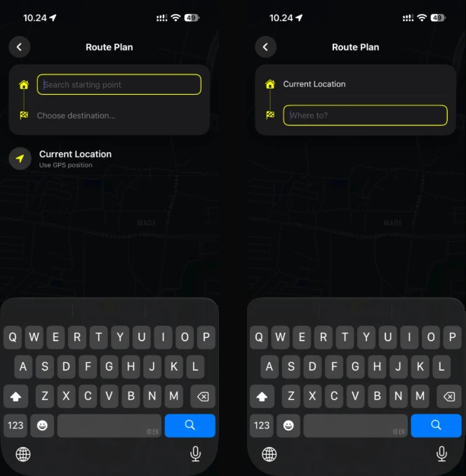
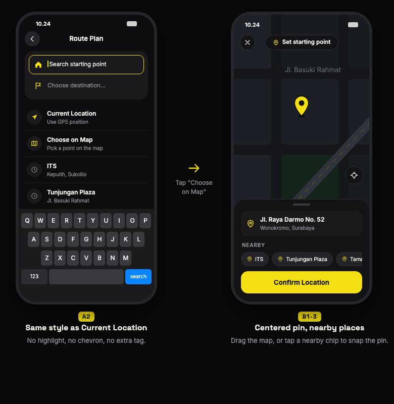

# 0027. Choose on map with native SwiftUI Map and MapKit

- Status: Proposed
- Date: 2026-11-12
- Deciders: O

## Context

Set Route and Edit Route share one planner (`SetRouteView` with one `MapViewModel`). A place can only be picked by typing in `RouteSearchSuggestionsList`; for a stop or destination with an empty search the list is blank. Issue [#311](https://github.com/C5-M3/Lezgo/issues/311) and issue [#312](https://github.com/C5-M3/Lezgo/issues/312) ask for picking the start point, stops and destination on the map.

Before:

Target: a "Choose on Map" row that looks like "Current Location", then a full-screen map with a pin fixed at the center, the address and nearby places in a bottom card, and one confirm button.

Facts that constrain the work:

- The deployment target is iOS 26.0, so every MapKit API for SwiftUI is available.
- The trip map already reads the map with `onMapCameraChange` (`TripMapView+MapLayer.swift`) and names a street with `MKReverseGeocodingRequest` (`LiveStreetNameService`).
- A picked place already flows through `MapViewModel.ApplySearchResult(_:)`, which sets the point, closes the search and finds the route.
- Apple limits how many geocoding and search requests an app may send, and `MapViewModel` already stays within MapKit's directions limit.
- [0022](0022-CustomTripMapControls.md) chose our own cards over Apple's system sheet for the trip map, so the design is matched exactly.

## Decision

We will build the picker with SwiftUI `Map` and MapKit only: a pin fixed over the map, the position read with `onMapCameraChange(frequency: .onEnd)`, the address from `MKReverseGeocodingRequest`, nearby places from `MKLocalSearch` with `MKLocalPointsOfInterestRequest`, and the bottom card drawn as our own view in a `safeAreaInset`.
The confirmed place goes through the existing `ApplySearchResult(_:)` path, so Set Route and Edit Route behave the same, and no dependency is added.

## Alternatives considered

- **Wrap `MKMapView` from UIKit:** gives finer camera control, but AGENTS.md allows no UIKit unless asked, and `Map` already provides what the pin needs.
- **Third-party map picker library:** AGENTS.md requires asking before adding a dependency, and none gives more than the native `Map` for a centered pin.
- **Tap to drop a pin (design B2):** less precise in a car mount and harder to use with one hand, so it was not chosen.
- **Apple's system sheet for the bottom card:** the sheet floats above everything and cannot follow the design, the same reason as in [0022](0022-CustomTripMapControls.md).
- **Reverse geocode on every camera change:** would break Apple's request limits while the map is dragged; we look up only when the map stops.
- **A second selection state next to `activeSelectionSheet`:** would let two places be picked at once; the picker reuses `ActivePointSelection` so there is one source of truth.

## Consequences

The design is matched with native building blocks, and Set Route and Edit Route get the feature at once because they share the planner.
We now own the dragging behaviour of the pin: lifting while the map moves, VoiceOver labels, Dynamic Type and a Confirm button that works without dragging ([Accessibility](../../AGENTS.md#accessibility-minimum-bar)).
Address and nearby lookups need the network and can fail, so the card has a fallback text and hides "Nearby" when empty.
Whether the safe area inset moves the camera center, and how Apple's location button looks on this card, must be checked in the simulator; if they clash with the design, the pin offset and the button become our own views.
Tests follow [0008](0008-TestDrivenDevelopment.md): the view models are tested with fake services.
